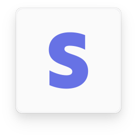
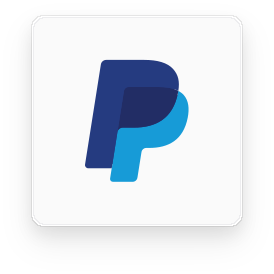

<p align="center">
  <a href="https://gorgojs.com">
    <picture>
      <source media="(prefers-color-scheme: dark)" srcset="https://raw.githubusercontent.com/gorgojs/medusa-integrations/refs/heads/main/assets/gorgo-logo-dark.svg">
      <source media="(prefers-color-scheme: light)" srcset="https://raw.githubusercontent.com/gorgojs/medusa-integrations/refs/heads/main/assets/gorgo-logo-light.svg">
      
    </picture>
  </a>
</p>
<h1 align="center">
  Medusa Integrations<br>
  by Gorgo
</h1>

<h4 align="center">
  <a href="https://docs.gorgojs.com">Documentation</a> |
  <a href="https://gorgojs.com">Website</a>
</h4>

<p align="center">
  Production-ready <a href="https://medusajs.com/">Medusa</a> plugins for payments, fulfillment, ERP and product feeds, with example apps and documentation.
</p>

<p align="center">
  <a href="https://github.com/gorgojs/medusa-integrations/blob/HEAD/README.ru.md">Читать README на русском ↗</a>
</p>

<p align="center">
  <a href="https://medusajs.com">
    
  </a>
  <a href="https://github.com/gorgojs/medusa-integrations/actions/workflows/update-medusa-version.yml">
    
  </a>
  <a href="https://github.com/gorgojs/medusa-integrations/actions/workflows/test.yml">
    
  </a>
</p>

<p align="center">
  <a href="https://t.me/gorgojs_chat">
    
  </a>
  <a href="https://t.me/medusajs_chat">
    
  </a>
</p>

## Integration Module

<p>
  <a href="./packages/modules/integration">
    
  </a>
  <strong><a href="./packages/modules/integration">Integration Module</a></strong><br/>
  Lets any plugin, provider or module declare its options, so store admins configure them under <strong>Settings → Integrations</strong> in the Medusa Admin without editing <code>medusa-config</code> or redeploying. It generates the Admin API, forms and validation for you. Every plugin below except the Yandex Market feed is configured through it.<br/>
  <a href="https://docs.gorgojs.com/medusa-modules/integration">docs</a> |
  <a href="https://www.npmjs.com/package/@gorgo/medusa-integration">npm</a> |
  <a href="./examples/all-integrations">example</a>
</p>

<br clear="left"/>

## Integrations

The plugins require Medusa 2.23.0 or later. A [daily workflow](.github/workflows/update-medusa-version.yml) runs their tests against every new Medusa release, and each plugin's README shows the newest version they passed on.

### Payments

<p>
  <a href="./packages/providers/payment-stripe">
    
  </a>
  <strong><a href="./packages/providers/payment-stripe">Stripe</a></strong><br/>
  Payment provider with Apple Pay, Google Pay and Link express checkout, one- and two-step payments, refunds, and a storefront example.<br/>
  <a href="https://docs.gorgojs.com/medusa-integrations/stripe">docs</a> |
  <a href="https://www.npmjs.com/package/@gorgo/medusa-payment-stripe">npm</a> |
  <a href="./examples/payment-stripe">example</a>
</p>

##

<br clear="left"/>

<p>
  <a href="./packages/providers/payment-paypal">
    
  </a>
  <strong><a href="./packages/providers/payment-paypal">PayPal</a></strong><br/>
  Payment provider with a PayPal express checkout button, one- and two-step payments, refunds, and a storefront example.<br/>
  <a href="https://docs.gorgojs.com/medusa-integrations/paypal">docs</a> |
  <a href="https://www.npmjs.com/package/@gorgo/medusa-payment-paypal">npm</a> |
  <a href="./examples/payment-paypal">example</a>
</p>

##

<br clear="left"/>

<p>
  <a href="./packages/providers/payment-mollie">
    
  </a>
  <strong><a href="./packages/providers/payment-mollie">Mollie</a></strong><br/>
  Payment provider with a hosted payment page that offers every method enabled in your Mollie profile, refunds, and a storefront example.<br/>
  <a href="https://docs.gorgojs.com/medusa-integrations/mollie">docs</a> |
  <a href="https://www.npmjs.com/package/@gorgo/medusa-payment-mollie">npm</a> |
  <a href="./examples/payment-mollie">example</a>
</p>

##

<br clear="left"/>

<p>
  <a href="./packages/providers/payment-authorizenet">
    
  </a>
  <strong><a href="./packages/providers/payment-authorizenet">Authorize.net</a></strong><br/>
  Payment provider with Google Pay express checkout, one- and two-step payments, refunds, and a storefront example.<br/>
  <a href="https://docs.gorgojs.com/medusa-integrations/authorizenet">docs</a> |
  <a href="https://www.npmjs.com/package/@gorgo/medusa-payment-authorizenet">npm</a> |
  <a href="./examples/payment-authorizenet">example</a>
</p>

##

<br clear="left"/>

<p>
  <a href="./packages/providers/payment-yookassa">
    
  </a>
  <strong><a href="./packages/providers/payment-yookassa">Yookassa</a></strong><br/>
  Payment provider with hosted checkout, webhook handling, refunds, fiscal receipts, and a storefront example.<br/>
  <a href="https://docs.gorgojs.com/medusa-integrations/yookassa">docs</a> |
  <a href="https://www.npmjs.com/package/@gorgo/medusa-payment-yookassa">npm</a> |
  <a href="./examples/payment-yookassa">example</a>
</p>

##

<br clear="left"/>

<p>
  <a href="./packages/providers/payment-tkassa">
    
  </a>
  <strong><a href="./packages/providers/payment-tkassa">T-Kassa by T-Bank</a></strong><br/>
  Payment provider with payment initialization, webhook handling, refunds, receipt support, and a storefront example.<br/>
  <a href="https://docs.gorgojs.com/medusa-integrations/t-kassa">docs</a> |
  <a href="https://www.npmjs.com/package/@gorgo/medusa-payment-tkassa">npm</a> |
  <a href="./examples/payment-tkassa">example</a>
</p>

##

<br clear="left"/>

<p>
  <a href="./packages/providers/payment-robokassa">
    
  </a>
  <strong><a href="./packages/providers/payment-robokassa">Robokassa</a></strong><br/>
  Payment provider with hosted checkout flows, notifications, refunds, receipt generation, and example storefront integration.<br/>
  <a href="https://docs.gorgojs.com/medusa-integrations/robokassa">docs</a> |
  <a href="https://www.npmjs.com/package/@gorgo/medusa-payment-robokassa">npm</a> |
  <a href="./examples/payment-robokassa">example</a>
</p>

##

<br clear="left"/>

### Fulfillment

<p>
  <a href="./packages/providers/fulfillment-apiship">
    
  </a>
  <strong><a href="./packages/providers/fulfillment-apiship">ApiShip</a></strong><br/>
  Fulfillment provider with delivery rate calculation, shipment creation, pickup-point delivery, document retrieval, and Admin tooling.<br/>
  <a href="https://docs.gorgojs.com/medusa-integrations/apiship">docs</a> |
  <a href="https://www.npmjs.com/package/@gorgo/medusa-fulfillment-apiship">npm</a> |
  <a href="./examples/fulfillment-apiship">example</a>
</p>

##

<br clear="left"/>

### ERP

<p>
  <a href="./packages/providers/erp-1c">
    
  </a>
  <strong><a href="./packages/providers/erp-1c">1C:Enterprise Catalog</a></strong><br/>
  Imports products, categories and prices from 1C:Enterprise into Medusa, with an example backend.<br/>
  <a href="https://docs.gorgojs.com/medusa-integrations/1c-enterprise-catalog">docs</a> |
  <a href="https://www.npmjs.com/package/@gorgo/medusa-1c">npm</a> |
  <a href="./examples/erp-1c">example</a>
</p>

##

<br clear="left"/>

The paid [1C:Enterprise](https://docs.gorgojs.com/medusa-integrations/1c-enterprise) plugin also exchanges stock and orders in both directions. It isn't part of this repository and is available to beta participants.

### Product Feeds

<p>
  <a href="./packages/providers/feed-yandex">
    
  </a>
  <strong><a href="./packages/providers/feed-yandex">Yandex Market YML Feed</a></strong><br/>
  Feed generator that exports catalog data in YML format and exposes feed management through Medusa Admin.<br/>
  <a href="https://docs.gorgojs.com/medusa-integrations/yandex-yml-feed">docs</a> |
  <a href="https://www.npmjs.com/package/@gorgo/medusa-feed-yandex">npm</a> |
  <a href="./examples/feed-yandex">example</a>
</p>

##

<br clear="left"/>

## Run an Example

Each plugin has an example app with a Medusa backend and a Next.js storefront. The ERP example and [all-integrations](examples/all-integrations), which loads every plugin into one store, have a backend only. [examples/README.md](examples/README.md) covers the prerequisites, the shared PostgreSQL in Docker Compose and the install steps.

## Repository Structure

This is a Yarn workspaces monorepo with shared dependencies and tooling.

```text
├── packages/
│   ├── modules/        # the Integration Module
│   ├── providers/      # one package per integration
│   └── utils/          # helpers shared by the plugins
├── examples/           # an example app per integration
├── integration-tests/  # a Medusa app per integration that boots it for HTTP and module tests
├── catalog/            # the integration registry behind the Browse tab in the Admin and gorgojs.com
├── docs/               # docs.gorgojs.com content
└── scripts/
```

## Tests

[Turborepo](https://turborepo.com) runs two kinds of tests:

- **Unit tests** sit next to the source in each package (`src/**/__tests__/*.unit.spec.ts`).
- **Integration tests** live in `integration-tests/<plugin>/` and boot a real Medusa app with the plugin loaded through `workspace:*`. [integration-tests/README.md](integration-tests/README.md) covers the prerequisites.

```bash
yarn test:unit          # unit tests of every package
yarn test:integration   # integration tests of every package
yarn test:changed       # both, only for packages changed against origin/main
```

CI runs the tests of changed packages on every pull request and push to `main`, and the full suite every night ([test.yml](.github/workflows/test.yml)). The [Maintenance](https://docs.gorgojs.com/resources/maintenance) page explains how we test, update and fix the plugins.

## Contributing

Contributions to packages, examples and docs are welcome. Before you open a pull request:

1. Run the checks for the area you touched, such as `yarn build` and `yarn test:changed` for a package or `yarn lint:content` for docs.
2. Update the docs when behavior, configuration or setup changes.
3. Write [Conventional Commits](https://www.conventionalcommits.org/en/v1.0.0/), such as `fix(payment-stripe): …`. The scope is the package you changed, and `yarn scopes` prints the full list. `commitlint` checks the message, and the release tooling turns it into a changeset.

Report a vulnerability privately as [SECURITY.md](SECURITY.md) describes, not in a public issue.

## Usage Data

The plugins send anonymous usage data, such as the plugin version and the Medusa version, to help prioritize fixes. [Usage Data](https://docs.gorgojs.com/resources/usage-data) lists what is collected, and `GORGO_DISABLE_TELEMETRY=true` turns it off.

## License

The published packages are released under the MIT License. See each package's `LICENSE` file for the exact terms.
