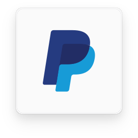

<p align="center">
  <a href="https://gorgojs.ru">
    <picture>
      <source media="(prefers-color-scheme: dark)" srcset="https://raw.githubusercontent.com/gorgojs/medusa-integrations/refs/heads/main/assets/gorgo-logo-dark.svg">
      <source media="(prefers-color-scheme: light)" srcset="https://raw.githubusercontent.com/gorgojs/medusa-integrations/refs/heads/main/assets/gorgo-logo-light.svg">
      
    </picture>
  </a>
</p>
<h1 align="center">
  Интеграции для Medusa<br>
  от Gorgo
</h1>

<h4 align="center">
  <a href="https://docs.gorgojs.ru">Документация</a> |
  <a href="https://gorgojs.ru">Сайт</a>
</h4>

<p align="center">
  Готовые к продакшену плагины <a href="https://medusajs.com/">Medusa</a> для платежей, доставки, ERP и товарных фидов. С примерами приложений и документацией.
</p>

<p align="center">
  <a href="https://github.com/gorgojs/medusa-integrations/blob/HEAD/README.md">Read README in English ↗</a>
</p>

<p align="center">
  <a href="https://medusajs.com">
    
  </a>
  <a href="https://github.com/gorgojs/medusa-integrations/actions/workflows/update-medusa-version.yml">
    
  </a>
  <a href="https://github.com/gorgojs/medusa-integrations/actions/workflows/test.yml">
    
  </a>
</p>

<p align="center">
  <a href="https://t.me/gorgojs_chat">
    
  </a>
  <a href="https://t.me/medusajs_chat">
    
  </a>
</p>

## Модуль интеграций

<p>
  <a href="./packages/modules/integration">
    
  </a>
  <strong><a href="./packages/modules/integration">Модуль интеграций</a></strong><br/>
  Плагин, провайдер или модуль описывает свои параметры, и администратор магазина меняет их в разделе <strong>Настройки → Интеграции</strong> в Medusa Admin без правки <code>medusa-config</code> и повторного развёртывания. API для Admin, формы и валидацию модуль создаёт сам. Через него настраиваются все плагины ниже, кроме фида для Яндекс Маркета.<br/>
  <a href="https://docs.gorgojs.ru/medusa-modules/integration">документация</a> |
  <a href="https://www.npmjs.com/package/@gorgo/medusa-integration">npm</a> |
  <a href="./examples/all-integrations">пример</a>
</p>

<br clear="left"/>

## Интеграции

Плагинам нужна Medusa 2.23.0 или новее. [Ежедневный воркфлоу](.github/workflows/update-medusa-version.yml) прогоняет их тесты на каждом новом релизе Medusa, а последняя версия, на которой они прошли, указана в README каждого плагина.

### Платежи

<p>
  <a href="./packages/providers/payment-yookassa">
    
  </a>
  <strong><a href="./packages/providers/payment-yookassa">ЮKassa</a></strong><br/>
  Провайдер платежей: создание платежей, обработка вебхуков, возвраты и фискальные чеки по 54-ФЗ. В комплекте пример витрины.<br/>
  <a href="https://docs.gorgojs.ru/medusa-integrations/yookassa">документация</a> |
  <a href="https://www.npmjs.com/package/@gorgo/medusa-payment-yookassa">npm</a> |
  <a href="./examples/payment-yookassa">пример</a>
</p>

##

<br clear="left"/>

<p>
  <a href="./packages/providers/payment-tkassa">
    
  </a>
  <strong><a href="./packages/providers/payment-tkassa">Т-Касса от Т-Банка</a></strong><br/>
  Провайдер платежей: создание платежей, обработка вебхуков, возвраты и фискальные чеки по 54-ФЗ. В комплекте пример витрины.<br/>
  <a href="https://docs.gorgojs.ru/medusa-integrations/t-kassa">документация</a> |
  <a href="https://www.npmjs.com/package/@gorgo/medusa-payment-tkassa">npm</a> |
  <a href="./examples/payment-tkassa">пример</a>
</p>

##

<br clear="left"/>

<p>
  <a href="./packages/providers/payment-robokassa">
    
  </a>
  <strong><a href="./packages/providers/payment-robokassa">Robokassa</a></strong><br/>
  Провайдер платежей: создание платежей, обработка уведомлений, возвраты и фискальные чеки по 54-ФЗ. В комплекте пример интеграции с витриной.<br/>
  <a href="https://docs.gorgojs.ru/medusa-integrations/robokassa">документация</a> |
  <a href="https://www.npmjs.com/package/@gorgo/medusa-payment-robokassa">npm</a> |
  <a href="./examples/payment-robokassa">пример</a>
</p>

##

<br clear="left"/>

<p>
  <a href="./packages/providers/payment-stripe">
    
  </a>
  <strong><a href="./packages/providers/payment-stripe">Stripe</a></strong><br/>
  Провайдер платежей с быстрой оплатой через Apple Pay, Google Pay и Link, одно- и двухстадийной оплатой и возвратами. В комплекте пример витрины.<br/>
  <a href="https://docs.gorgojs.ru/medusa-integrations/stripe">документация</a> |
  <a href="https://www.npmjs.com/package/@gorgo/medusa-payment-stripe">npm</a> |
  <a href="./examples/payment-stripe">пример</a>
</p>

##

<br clear="left"/>

<p>
  <a href="./packages/providers/payment-paypal">
    
  </a>
  <strong><a href="./packages/providers/payment-paypal">PayPal</a></strong><br/>
  Провайдер платежей с кнопкой быстрой оплаты PayPal, одно- и двухстадийной оплатой и возвратами. В комплекте пример витрины.<br/>
  <a href="https://docs.gorgojs.ru/medusa-integrations/paypal">документация</a> |
  <a href="https://www.npmjs.com/package/@gorgo/medusa-payment-paypal">npm</a> |
  <a href="./examples/payment-paypal">пример</a>
</p>

##

<br clear="left"/>

<p>
  <a href="./packages/providers/payment-mollie">
    
  </a>
  <strong><a href="./packages/providers/payment-mollie">Mollie</a></strong><br/>
  Провайдер платежей с оплатой на странице Mollie всеми способами, включёнными в профиле, и возвратами. В комплекте пример витрины.<br/>
  <a href="https://docs.gorgojs.ru/medusa-integrations/mollie">документация</a> |
  <a href="https://www.npmjs.com/package/@gorgo/medusa-payment-mollie">npm</a> |
  <a href="./examples/payment-mollie">пример</a>
</p>

##

<br clear="left"/>

<p>
  <a href="./packages/providers/payment-authorizenet">
    
  </a>
  <strong><a href="./packages/providers/payment-authorizenet">Authorize.net</a></strong><br/>
  Провайдер платежей с быстрой оплатой через Google Pay, одно- и двухстадийной оплатой и возвратами. В комплекте пример витрины.<br/>
  <a href="https://docs.gorgojs.ru/medusa-integrations/authorizenet">документация</a> |
  <a href="https://www.npmjs.com/package/@gorgo/medusa-payment-authorizenet">npm</a> |
  <a href="./examples/payment-authorizenet">пример</a>
</p>

##

<br clear="left"/>

### Доставка

<p>
  <a href="./packages/providers/fulfillment-apiship">
    
  </a>
  <strong><a href="./packages/providers/fulfillment-apiship">ApiShip</a></strong><br/>
  Провайдер доставки: расчёт тарифов, создание отправлений, доставка в пункты выдачи, получение сопроводительных документов и управление из Medusa Admin.<br/>
  <a href="https://docs.gorgojs.ru/medusa-integrations/apiship">документация</a> |
  <a href="https://www.npmjs.com/package/@gorgo/medusa-fulfillment-apiship">npm</a> |
  <a href="./examples/fulfillment-apiship">пример</a>
</p>

##

<br clear="left"/>

### ERP

<p>
  <a href="./packages/providers/erp-1c">
    
  </a>
  <strong><a href="./packages/providers/erp-1c">1С:Предприятие Каталог</a></strong><br/>
  Импорт товаров, категорий и цен из 1С:Предприятия в Medusa. В комплекте пример backend-приложения.<br/>
  <a href="https://docs.gorgojs.ru/medusa-integrations/1c-enterprise-catalog">документация</a> |
  <a href="https://www.npmjs.com/package/@gorgo/medusa-1c">npm</a> |
  <a href="./examples/erp-1c">пример</a>
</p>

##

<br clear="left"/>

Платный плагин [1С:Предприятие](https://docs.gorgojs.ru/medusa-integrations/1c-enterprise) дополнительно передаёт остатки и заказы между Medusa и 1С в обе стороны. Он не входит в этот репозиторий и доступен участникам бета-тестирования.

### Товарные фиды

<p>
  <a href="./packages/providers/feed-yandex">
    
  </a>
  <strong><a href="./packages/providers/feed-yandex">YML-фид для Яндекс Маркета</a></strong><br/>
  Экспорт каталога в формате YML (Yandex Market Language) с управлением фидами из Medusa Admin.<br/>
  <a href="https://docs.gorgojs.ru/medusa-integrations/yandex-yml-feed">документация</a> |
  <a href="https://www.npmjs.com/package/@gorgo/medusa-feed-yandex">npm</a> |
  <a href="./examples/feed-yandex">пример</a>
</p>

##

<br clear="left"/>

## Запуск примера

У каждого плагина есть пример с бэкендом Medusa и витриной на Next.js. В примере для 1С и в [all-integrations](examples/all-integrations), где все плагины подключены к одному магазину, есть только бэкенд. Требования, общий PostgreSQL в Docker Compose и шаги установки описаны в [examples/README.md](examples/README.md).

## Структура репозитория

Репозиторий устроен как монорепозиторий на Yarn workspaces с общими зависимостями и инструментами.

```text
├── packages/
│   ├── modules/        # Модуль интеграций
│   ├── providers/      # по пакету на каждую интеграцию
│   └── utils/          # общие для плагинов пакеты
├── examples/           # пример приложения для каждой интеграции
├── integration-tests/  # приложение Medusa для HTTP- и модульных тестов каждой интеграции
├── catalog/            # реестр интеграций для вкладки Browse в Admin и для gorgojs.com
├── docs/               # содержимое docs.gorgojs.com и docs.gorgojs.ru
└── scripts/
```

## Тесты

Тесты двух видов запускает [Turborepo](https://turborepo.com):

- **Юнит-тесты** находятся рядом с исходниками каждого пакета (`src/**/__tests__/*.unit.spec.ts`).
- **Интеграционные тесты** находятся в `integration-tests/<plugin>/`. Они поднимают настоящее приложение Medusa с плагином, подключённым через `workspace:*`. Требования описаны в [integration-tests/README.md](integration-tests/README.md).

```bash
yarn test:unit          # юнит-тесты всех пакетов
yarn test:integration   # интеграционные тесты всех пакетов
yarn test:changed       # оба вида, только для пакетов, изменённых относительно origin/main
```

CI запускает тесты изменённых пакетов на каждый pull request и на каждое изменение в `main`, а полный набор каждую ночь ([test.yml](.github/workflows/test.yml)). Как мы тестируем, обновляем и исправляем плагины, рассказано на странице [Сопровождение](https://docs.gorgojs.ru/resources/maintenance).

## Как внести вклад

Мы рады вкладу в пакеты, примеры и документацию. Перед тем как открыть pull request:

1. Запустите проверки для изменённой области, например `yarn build` и `yarn test:changed` для пакета или `yarn lint:content` для документации.
2. Обновите документацию, если меняется поведение, конфигурация или порядок установки.
3. Оформите коммиты по [Conventional Commits](https://www.conventionalcommits.org/ru/v1.0.0/), например `fix(payment-tkassa): …`. Scope совпадает с изменённым пакетом, полный список выводит `yarn scopes`. Сообщение проверяет `commitlint`, а инструменты релиза делают из него changeset.

Об уязвимости сообщайте закрыто, как описано в [SECURITY.md](SECURITY.md), а не в публичном issue.

## Данные об использовании

Плагины отправляют анонимные данные об использовании, например версию плагина и версию Medusa. Они помогают решить, что исправлять в первую очередь. Полный список собираемых данных есть на странице [Данные об использовании](https://docs.gorgojs.ru/resources/usage-data), а сбор отключает `GORGO_DISABLE_TELEMETRY=true`.

## Лицензия

Опубликованные пакеты распространяются по лицензии MIT. Точные условия находятся в файле `LICENSE` каждого пакета.
