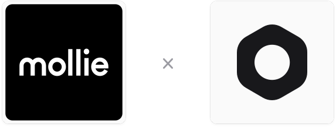

  

# {frontmatter.title}

A Medusa plugin that provides Mollie payments.

  <video
    controls
    preload="metadata"
    poster="https://static.gorgojs.com/videos/payment-mollie/demo/payment-mollie-demo-en-poster.2cf7303b.webp"
    className="block w-full max-w-[720px] rounded-lg"
    aria-label="Mollie plugin demo video"
  >
    <source
      src="https://static.gorgojs.com/videos/payment-mollie/demo/payment-mollie-demo-en.cccb587f.mp4"
      type="video/mp4"
    />
  </video>

## Plugin Features

- **Full Integration with Mollie:** Connect your store to Mollie and accept payments on Mollie's hosted payment page.
- **Every Payment Method of Your Profile:** The buyer picks a card, iDEAL, Bancontact, PayPal or any other method you enabled in Mollie, with no code per method.
- **One-Step & Two-Step Payments:** Autocapture or authorization/hold payment flows.
- **Refunds & Cancellations:** Full and partial refunds, cancellation of open payments and release of held amounts.
- **Webhook Notifications:** The order is placed once Mollie reports the payment as paid, even if the buyer never returns to the store. The plugin reads every notification back from Mollie, so a forged one changes nothing.
- **Detailed Logging:** Request and response logs for debugging and support in development mode.
- **Full Test Coverage:** Comprehensive unit and integration tests covering core flows and edge cases.
- **Storefront Example:** A complete <a href="https://github.com/gorgojs/medusa-integrations/tree/main/examples/payment-mollie/apps/storefront" target="_blank">Next.js storefront</a> ready to use as a reference.
- **[Integration module](/medusa-modules/integration)**<AccentBadge badge="New" />: Configure this plugin directly in the Medusa Admin application – no editing configuration files or redeploying the store.

<Note type="default" title="What Is the Integration Module?">The Integration module lets any plugin declare its options as a schema, so a store administrator can configure them in the Medusa Admin, with no `medusa-config` edits and no redeploy. The module takes care of the UI, storage, encryption and validation. Read more in [this documentation](/medusa-modules/integration).</Note>

---

## What Is Mollie

Mollie is a payment service provider based in Amsterdam. It lets online stores accept cards, wallets such as Apple Pay and PayPal, and local payment methods such as iDEAL, Bancontact, Klarna and bank transfer through one account. Learn more at the <a href="https://www.mollie.com/" target="_blank">Mollie website</a>.

---

## Development

<CardList items={[
  {
    title: "Bootstrapping a development environment",
    href: "https://github.com/gorgojs/medusa-integrations/tree/main/examples/payment-mollie"
  },
  {
    title: "Changelog",
    href: "/medusa-integrations/mollie/changelog"
  }
]}/>

---

## 💬  Support & Community

Got questions or ideas about the plugin? Join the Telegram support chat – [@gorgojs_chat](https://t.me/gorgojs_chat)

Connect with other Medusa developers on Telegram – [@medusajs_chat](https://t.me/medusajs_chat)
