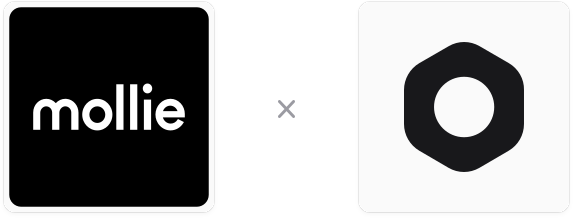

  

# {frontmatter.title}

Плагин Medusa для приёма платежей через Mollie.

  <video
    controls
    preload="metadata"
    poster="https://static.gorgojs.com/videos/payment-mollie/demo/payment-mollie-demo-ru-poster.f71ef010.webp"
    className="block w-full max-w-[720px] rounded-lg"
    aria-label="Демо-видео плагина Mollie"
  >
    <source
      src="https://static.gorgojs.com/videos/payment-mollie/demo/payment-mollie-demo-ru.5d6b4c37.mp4"
      type="video/mp4"
    />
  </video>

## Возможности плагина

- **Полная интеграция с Mollie:** Подключение магазина к Mollie и приём оплаты на платёжной странице Mollie.
- **Все способы оплаты вашего профиля:** Покупатель выбирает карту, iDEAL, Bancontact, PayPal или любой другой способ, включённый у вас в Mollie, без отдельного кода под каждый способ.
- **Одно- и двухстадийная оплата:** Автосписание или авторизация с холдированием.
- **Возвраты и отмены:** Полные и частичные возвраты, отмена неоплаченных платежей и снятие холдирования.
- **Вебхук-уведомления:** Заказ создаётся, как только Mollie сообщает об оплате, даже если покупатель не вернулся в магазин. Плагин перепроверяет каждое уведомление в Mollie, поэтому поддельное ничего не меняет.
- **Подробное логирование:** Логи запросов и ответов для отладки и поддержки в режиме разработки.
- **Полное тестовое покрытие:** Юнит- и интеграционные тесты, покрывающие основные сценарии и граничные случаи.
- **Пример витрины магазина:** Готовый <a href="https://github.com/gorgojs/medusa-integrations/tree/main/examples/payment-mollie/apps/storefront" target="_blank">пример витрины на Next.js</a> для использования как референс.
- **[Модуль интеграций](/medusa-modules/integration)**<AccentBadge badge="New" />: Настройте плагин прямо в приложении Medusa Admin – без редактирования конфигурационных файлов и повторного развёртывания магазина.

<Note type="default" title="Что такое Модуль интеграций?">Модуль интеграций позволяет любому плагину описывать свои параметры в виде схемы и даёт администратору магазина настраивать их в Medusa Admin, без правок `medusa-config` и без повторного развёртывания. UI, хранение, шифрование и валидацию модуль берёт на себя. Читайте подробнее в [этой документации](/medusa-modules/integration).</Note>

---

## Что такое Mollie

Mollie - платёжный сервис из Амстердама. Через один аккаунт интернет-магазин принимает оплату картами, кошельками вроде Apple Pay и PayPal и местными способами оплаты, такими как iDEAL, Bancontact, Klarna и банковский перевод. Подробнее на <a href="https://www.mollie.com/" target="_blank">сайте Mollie</a>.

---

## Разработчикам

<CardList items={[
  {
    title: "Развёртывание окружения для разработки",
    href: "https://github.com/gorgojs/medusa-integrations/tree/main/examples/payment-mollie"
  },
  {
    title: "История изменений",
    href: "/medusa-integrations/mollie/changelog"
  }
]}/>

---

## 💬  Поддержка и сообщество

Есть вопросы по плагину или идеи? Пишите в чат поддержки в Telegram – [@gorgojs_chat](https://t.me/gorgojs_chat)

Общайтесь с другими разработчиками Medusa в Telegram – [@medusajs_chat](https://t.me/medusajs_chat)
