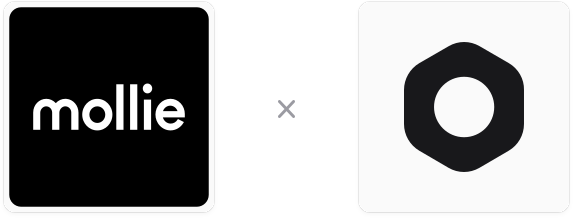

<p align="center">
  <a href="https://docs.gorgojs.com/medusa-integrations/mollie">
    
  </a>
</p>

<h1 align="center">
Mollie Payments for Medusa
</h1>

<p align="center">
  <a href="https://docs.gorgojs.com/medusa-integrations/mollie">Documentation</a>
  <br/>
  A Medusa plugin that provides Mollie payments.
</p>

<br/>

<p align="center">
  <a href="https://medusajs.com">
    
  </a>
  <a href="https://github.com/gorgojs/medusa-integrations/actions/workflows/update-medusa-version.yml">
    
  </a>
  <a href="https://www.npmjs.com/package/@gorgo/medusa-payment-mollie">
    
  </a>
</p>

<p align="center">
  <a href="https://t.me/gorgojs_chat">
    
  </a>
</p>

<p align="center">
  <a href="https://t.me/medusajs_chat">
    
  </a>
</p>

<p align="center">
  <a href="https://static.gorgojs.com/videos/payment-mollie/demo/payment-mollie-demo-en.cccb587f.mp4">
    
  </a>
</p>

<p align="center">
  <a href="https://static.gorgojs.com/videos/payment-mollie/demo/payment-mollie-demo-en.cccb587f.mp4">▶ Watch the demo video</a>
</p>

## Plugin Features

- **Full Integration with Mollie:** Connect your store to Mollie and accept payments on Mollie's hosted payment page.
- **Every Payment Method of Your Profile:** The buyer picks a card, iDEAL, Bancontact, PayPal or any other method you enabled in Mollie, with no code per method.
- **One-Step & Two-Step Payments:** Autocapture or authorization/hold payment flows.
- **Refunds & Cancellations:** Full and partial refunds, cancellation of open payments and release of held amounts.
- **Webhook Notifications:** The order is placed once Mollie reports the payment as paid, even if the buyer never returns to the store. The plugin reads every notification back from Mollie, so a forged one changes nothing.
- **Detailed Logging:** Request and response logs for debugging and support in development mode.
- **Full Test Coverage:** Comprehensive unit and integration tests covering core flows and edge cases.
- **Storefront Example:** A complete <a href="https://github.com/gorgojs/medusa-integrations/tree/main/examples/payment-mollie/apps/storefront" target="_blank">Next.js storefront</a> ready to use as a reference.
- **[Integration module](https://gorgojs.com/medusa-integration-module)  :** Configure this plugin directly in the Medusa Admin application – no editing configuration files or redeploying the store.

> **Integration Module:** This plugin supports the Integration module, which lets store administrators configure it directly in the Medusa Admin application instead of editing configuration files and redeploying the store. Sensitive values are encrypted, and settings are validated before they take effect.

## What is Mollie

With Mollie, the buyer pays on Mollie's hosted payment page and chooses there among the methods enabled on your website profile, so card details never reach your server. The plugin talks to Mollie through Mollie's official Node SDK, `mollie-api-typescript`. Mollie's test mode accepts only EUR.

## 💬 Support & Community

Got questions or ideas about the plugin? Join the Telegram support chat, [@gorgojs_chat](https://t.me/gorgojs_chat).

Connect with other Medusa developers on Telegram in [@medusajs_chat](https://t.me/medusajs_chat).

## Requirements

- Medusa v2.17.2 or later
- Node.js v22.23.4, v24.22.1, v26.12.1 or later
- A Mollie account and the API key of its website profile, from **Developers → API keys** in the Mollie Web App
- Integration Module

## Installation

```bash
yarn add @gorgo/medusa-integration @gorgo/medusa-payment-mollie
# or
npm install @gorgo/medusa-integration @gorgo/medusa-payment-mollie
```

## Replacing a Community Mollie Plugin

Community plugins such as `@variablevic/mollie-payments-medusa` register one provider per payment method. This plugin registers one provider, `pp_mollie_mollie`, and lets the buyer choose the method on Mollie's page. Medusa sends the refund of a payment to the provider that created it, so the payments of the old plugin stay with it. See [Switch from a Community Mollie Plugin](https://docs.gorgojs.com/medusa-integrations/mollie/getting-started#switch-from-a-community-mollie-plugin) for the steps.

## Documentation

The complete installation, configuration, and usage guide for this plugin is available on the [Gorgo documentation website](https://docs.gorgojs.com/medusa-integrations/mollie).

## License

Licensed under the [MIT License](LICENSE).
